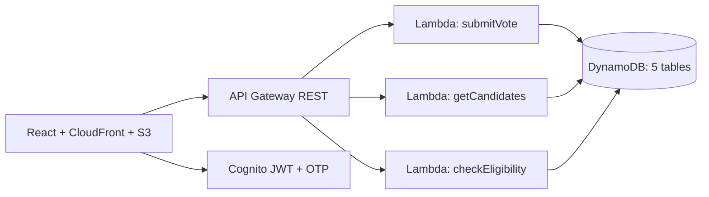

<div align="center">

# Online Voting System

Serverless voting platform on AWS for college elections: OTP auth, animated results, admin controls.

[](https://github.com/prathameshlonare/Online-voting-system/blob/main/LICENSE.txt)
[](https://github.com/prathameshlonare/Online-voting-system/actions)
[](https://github.com/prathameshlonare/Online-voting-system/stargazers)

</div>

## Table of Contents

- [What is this?](#what-is-this)
- [Why?](#why)
- [Quick Start](#quick-start)
- [Architecture](#architecture)
- [Tech Stack](#tech-stack)
- [Project Structure](#project-structure)
- [DevOps Engineering & Documentation](#devops-engineering--documentation)
- [Features](#features)
- [CI/CD Pipeline](#cicd-pipeline)
- [Screenshots](#screenshots)
- [Contributing](#contributing)
- [Connect](#connect)
- [Team](#team)
- [License](#license)

## What is this?

A React single page application backed by Python AWS Lambda functions, DynamoDB, Cognito, and API Gateway, automated with Terraform and Docker. Built for college departmental elections with student eligibility validated against attendance records. Includes a full offline mock mode for local development and demonstration without cloud dependencies.

> **Live Demo:** https://prathameshlonare.me/voting/ (runs with client-side mock data, no AWS setup needed).
>
> **Demo logins (1-click fill on login page):**
> | Role | Email | Password |
> |------|-------|----------|
> | Voter (Student) | `student@rcert.edu` | `password123` |
> | Admin | `admin@rcert.edu` | `admin123` |

## Why?

Our college department previously voted by writing candidate initials for President and Secretary on paper chits, dropping them into a ballot box, and tallying counts by hand. We replaced that process with this serverless platform, validating voter eligibility against attendance CSV records uploaded by the election administrator.

## Quick Start

```bash
# Clone repository
git clone https://github.com/prathameshlonare/Online-voting-system.git
cd Online-voting-system

# Demo frontend locally (offline mock mode, no backend needed)
cd frontend
yarn install
yarn start
# Open http://localhost:3000
```

```bash
# Run local container stack
cd docker
docker compose up --build
# Open http://localhost:3000
```

```bash
# Infrastructure verification (Plan-only / Test-only)
cd infra/terraform
terraform init
terraform validate
terraform plan
```

## Architecture




## Tech Stack

| Layer | Technology | Purpose |
|:---|:---|:---|
| **Frontend** | React 18, Material UI, React Router v6 | Single page voter and admin interface |
| **Backend** | Python 3.9, AWS Lambda, API Gateway REST | 12 serverless micro-handlers |
| **Authentication** | Amazon Cognito User Pool | Voter registration, OTP verification, JWT auth |
| **Database** | Amazon DynamoDB (5 tables) | On-demand storage for votes, candidates, users |
| **Storage** | Amazon S3 | Frontend static hosting and student CSV uploads |
| **Infrastructure as Code** | Terraform | Declarative infrastructure definition and management |
| **Containerization** | Docker, Docker Compose | Multi-stage build (Node -> Nginx Alpine) for local testing |
| **CI/CD** | GitHub Actions | Automated linting, unit tests, container build, Trivy scan |
| **Local Orchestration** | Kubernetes on kind | Declarative Deployments, Services, and Probes |

## Project Structure

```text
Online-voting-system/
├── backend/
│   └── lambda/            # 12 Python Lambda microservices (submitVote, checkEligibility, ...)
├── docker/                # Docker compose and local mock configurations
├── docs/                  # Engineering evidence, baseline, troubleshooting, and metrics
│   └── baseline.md        # Architectural audit and college baseline demarcation
├── frontend/              # React 18 single page application source code
├── infra/
│   └── terraform/         # Declarative AWS infrastructure (DynamoDB, Cognito, IAM, Lambda)
├── k8s/                   # Native Kubernetes manifests (Deployment, Service, ConfigMap)
├── screenshots/           # Application screenshots and architecture diagrams
├── .github/
│   └── workflows/         # GitHub Actions CI/CD workflows
├── DEVOPS-PLAN.md         # Single source of truth for DevOps transformation gates
├── LICENSE.txt            # MIT License
└── README.md
```

## DevOps Engineering & Documentation

Every DevOps enhancement in this repository follows strict engineering verification. No unmeasured performance metrics or inflated numbers are included.

| Document | Purpose |
|:---|:---|
| [DEVOPS-PLAN.md](DEVOPS-PLAN.md) | Single source of truth: 6 transformation gates and definition of done |
| [docs/baseline.md](docs/baseline.md) | Architectural audit separating college core from new DevOps layer |
| [docs/METRICS.md](docs/METRICS.md) | Verified metrics ledger (commit SHA, command, recorded measurement) |
| [docs/troubleshooting.md](docs/troubleshooting.md) | Real engineering incident root cause analyses (RCA) |

## Features

### Voters
- Student registration with email and OTP confirmation.
- Step-by-step voting wizard (Login -> Verification -> Select Candidate -> Confirm -> Submit).
- Real-time election status indicator (Pending, Live, Closed, Declared).
- Animated result visualization with celebratory indicators.

### Administrators
- Lifecycle controls: Start election, freeze voting, declare results, and reset cycle.
- Candidate roster management (add and review contesting candidates).
- Student attendance master CSV upload for eligibility gating.

### DevOps & Reliability
- Zero-cost test-only infrastructure management with Terraform.
- Multi-stage Docker image packaging for minimal attack surface.
- Uncheated CI pipeline with automated unit testing and container vulnerability scanning.
- Local Kubernetes deployment manifests verified on kind with self-healing probes.

## CI/CD Pipeline

```text
Push / Pull Request
        │
        ▼
1. Dependency Installation (cached via yarn.lock)
        │
        ▼
2. Code Linting & Static Checks
        │
        ▼
3. Unit Test Suite (Jest test execution)
        │
        ▼
4. Docker Multi-Stage Build
        │
        ▼
5. Container Security Scan (Trivy CRITICAL/HIGH CVE check)
```

## Screenshots

| Screen | Preview |
|---|---|
| **Login** (Voter / Admin entry) |  |
| **Sign Up** (Registration + OTP step) |  |
| **Welcome** (Landing page with election status) |  |
| **Vote Form** (Ballot for President and Secretary) |  |
| **Election Control** (Admin controls: start, stop, declare) |  |
| **Add Candidate** (Admin candidate configuration) |  |
| **Vote Confirmation** (Receipt screen after submission) |  |
| **Results** (Election outcome visualization) |  |

## Contributing

Pull Requests are welcome. Run tests before submitting:

```bash
cd frontend
yarn install
yarn test --watchAll=false
```

## Team

**Prathamesh Lonare**
- [LinkedIn](https://www.linkedin.com/in/prathamesh-lonare21/)
- [GitHub](https://github.com/prathameshlonare)
- [Portfolio](https://prathameshlonare.me)

**College Project Contributors:** Swapnil Kumbhare, Mohak Talodhikar, Suyog Madavi (departmental election application team).

## License

MIT License. See [LICENSE.txt](LICENSE.txt) for details.
